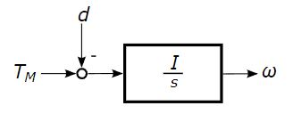

# Problem 846

The figure shows a simplified quarter vehicle modal. The drive torque T(M) is the input, the wheel speed W is the output of the system. The torque due to the acceleration of the vehicle is modelled by the constant disturbance d. I models the inertia of the wheel and s is the complex variable of the Laplace transform.\n\nWhich statements are correct? Mark all correct answers.

Options:
- A) The plant model is a linear system.
- B) The plant model is a nonlinear system.
- C) The plant model is a time variant system.
- D) The plant model is a time invariant system.
- E) The plant model is causal system.
- F) The plant model is an acausal system.
- G) The plant model is BIBO-stable system.
