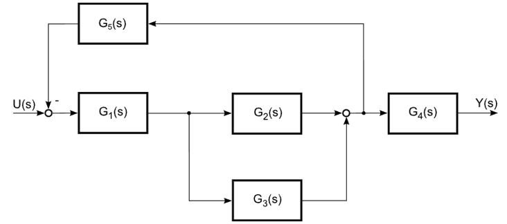
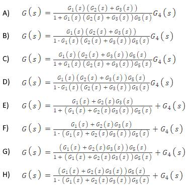

# Problem 847

The figure shows a block diagram of a dynamic system.\nWhat is the overall transfer function of the system?\nMark the correct answer.

Options:
- A) A
- B) B
- C) C
- D) D
- E) E
- F) F
- G) G
- H) H
