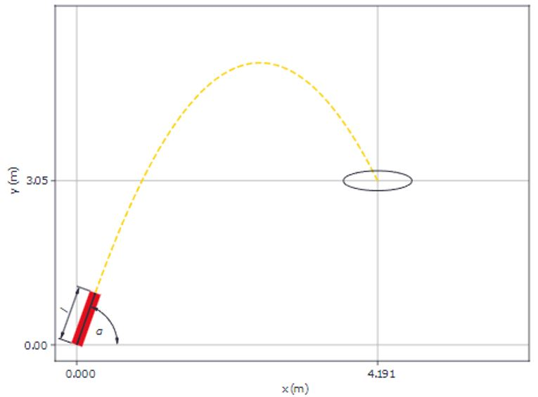

# Problem 849

You built a cannon to impress your friends with a basketball trickshot. It has a railgun-style accelerator with a length / of 1 m. Your cannon is tilted upwards by an angle a of 77.25° and is placed as depicted with the lower part in the origin of the coordinate system. The cannonball has a mass m of 0.567 kg. Assume that the capacitors have a total capacity C of 33 mF, that the standard acceleration due to gravity 9, is 980.665 cm/s^2 and that there is no friction and no energy loss.\nWhat voltage do you need to charge the capacitors supplying the railgun to, in order to hit the basket at (4.191 m, 3.05 m). Round to the nearest one.

