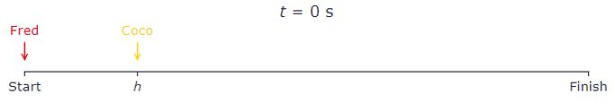

# Problem 850

Fred, the racing alpaca, challenges Coco, the 3-leged cat, to an acceleration event according to D 5.1.1. Being very confident, Fred gives Coco a head start h of 14 m infront of the start line. Both start the same time t=0 s having an initial speed V0 of 0m/s as shown in the figure. Coco accelerates with 6m/s^2. Assume that both are not limited by speed and have a constant acceleraton over the full acceleration event. \n\nCalculate the minimum acceleration Fred needs to achieve to reach the finish line at the same time as Coco. Round to one decimal.

