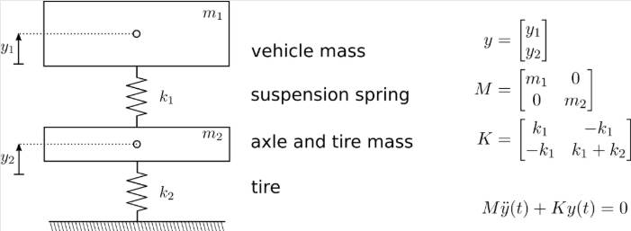

# Problem 86

The free vertical oscillation of a vehicle without dampers and without rubber damping can be modeled by the differential equation M*ÿ(t) + K*y(t) = 0 with the matrices as given in the figure. The vehicle mass is assumed to b m1 = 800k, the axlemass m2 = 60kg, the spring stiffnesses are k1 = 170N/cm and k2 = 1800 N/cm. What is the lowest resulting eigenfrequency of the system?
Enter the solution in Hertz and round solution to two decimal places.

