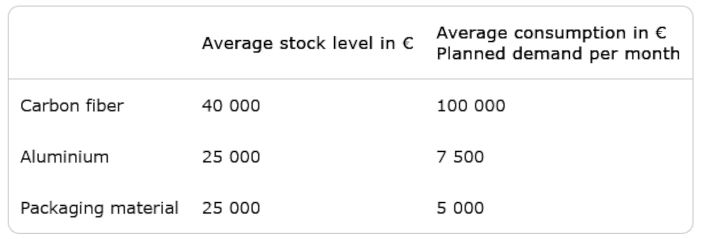

# Problem 941

Your team's CFO told you to support them with the team's warehouse management for the end of year reporting to your alumni. You collect the following data from your workshop.
Calculate the average storage time for carbon fiber in full days.
Note: Assume 30 days per month and 360 days per year

