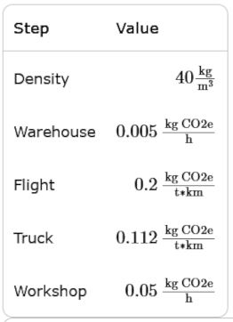

# Problem 944

Shortly before the competition, you notice that one of your drivers is too short to fit into your vehicle.You need a booter cushion in the size of 350mm * 350mm * 138mm to increase your driver's height while seated in the vehicle. The fastest way of ordering is online, but there are only packs of 2 foam cushions available, with a size of 1000mm * 1000mm * 138 mm per cushion. You decide to order using express delivery.
After ordering, the cushion is commissioned in the warehouse, where it had been stored for 10 days. The cushion is then delivered to your workshop by plane 15000km and truck 450km.
In the workshop, a team member takes 33 minutes to cut the cushion to size, but unfortunately the cushion too small after measuring, so they have to repeat the cutting process once to make a fitting cushion.
How large is the value of the outlined steps in kgCO2e?

