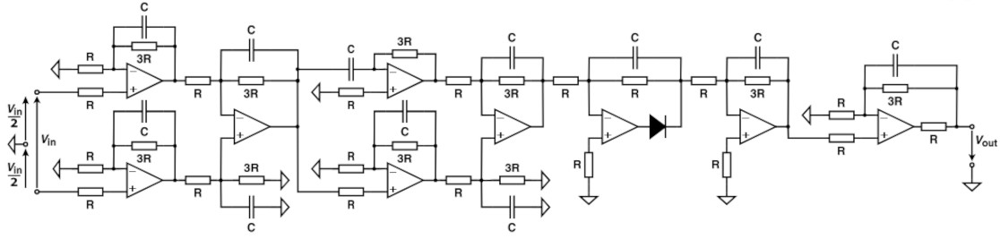

# Problem 946

The schematic shows an analog input frontend.All components, including operational amplifiers and diodes, are to be considered ideal. The ideal diode has a forward voltage of 0.6 V at any current and no leakage current in reverse direction at any voltage. The ideal operational amplifier has no input bias current, no input offset voltage Vout in mV for Vin=18mV, R=1kOhm, 3R= 3*R and C=197nF in steady state, round to the nearest one.

