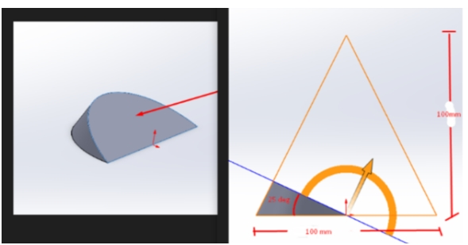

# Problem 692

The following shape on the left is a section view of the cone in the right. Calculate the area that is shown in the left.

Options:
- A) 5.1549 in^2
- B) 3325.76 cm^2
- C) 235.2633 mm^2
- D) Not enough information
