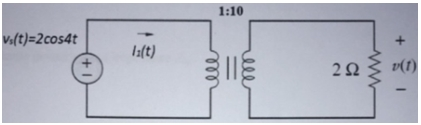

# Problem 698

For the following circuit, used as an ideal transformer with turn n=10.  Determine the impendence reflected to the primary ZR and the current I(t) through the source.

Options:
- A) ZR = 0.2 ohms, I(t)= 20 A
- B) ZR = 0.4 ohms, I(t)= 25 A
- C) ZR = 0.02 ohms, I(t)= 100 A
- D) ZR = 0.1 ohms, I(t)= 500 A
