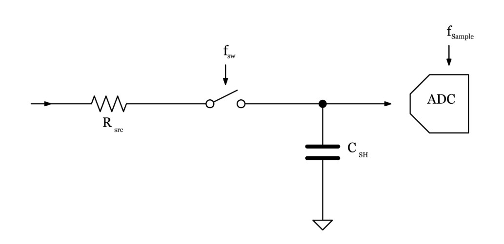

# Problem 975

You are using a 12-bit SAR ADC with a 2.5V reference to measure the current passing through a DRS actuator solenoid. To improve resolution, you decide to use oversampling and decimation to achieve an effective resolution of 14 bits. But the ADC clock frequency must be increased. The ADC has an internal sampling capacitor Csh=150 nF. The total equivalent source resistance (after buffering the signal) is Rsrc=2.2k. What’s the maximum allowed current frequency of the DRS solenoid for the voltage error to be at least (1/2)LSB? (2 Points for CV / 4 Points for EV)

Options:
- A) 4 / 21.64 Hz
- B) 16 / 8.37 Hz
- C) 16 / 122.34 Hz
- D) 4 / 10 Hz
