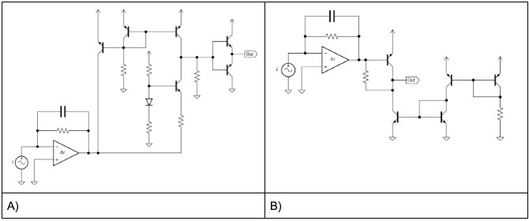

# Problem 977

Which configuration provides an output signal that is in phase with the current source, and what’s the middle stage of drawing A? (2 Points for CV / 4 Points for EV)

Options:
- A) A / Push-Pull
- B) B / Common Collector
- C) A / Common Emitter
- D) B / Common Base
