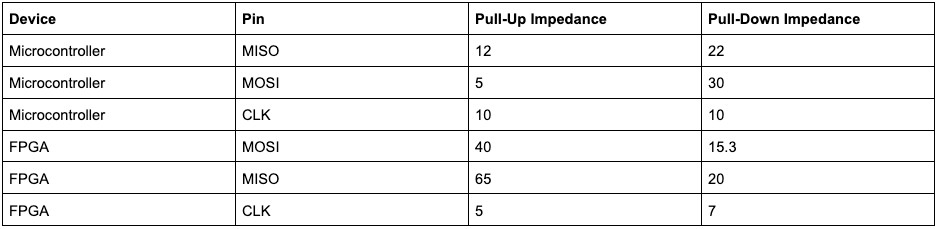

# Problem 978

You are integrating a Microcontroller (MCU) and an FPGA for a Control Unit (CU). The MCU acquires data from four ADCs over an I2C interface and sends them back to the master FPGA, which is running the complete algorithm of the CU over a 30MHz SPI interface. During initial testing, the CU algorithm reports intermittent checksum errors. Oscilloscope probing reveals significant ringing and overshoot on the clock and data lines, which you suspect is due to impedance mismatching over the PCB traces. Those traces have been designed with a controlled characteristic impedance of 70Ω with a nominal board thickness of 1.57mm. To mitigate this issue, you decide to add a series termination resistance. You are provided with the following characterization data from the component datasheets. Find the value of the termination resistor for each trace. EIA-96 resistors must be used.
Format: R_{device_pin1}=XX.X, R_{device_pin2}=YY.Y, …. Example: R_{FPGA_MISO}=1002.2 (2 Points for CV / 6 Points for EV)

