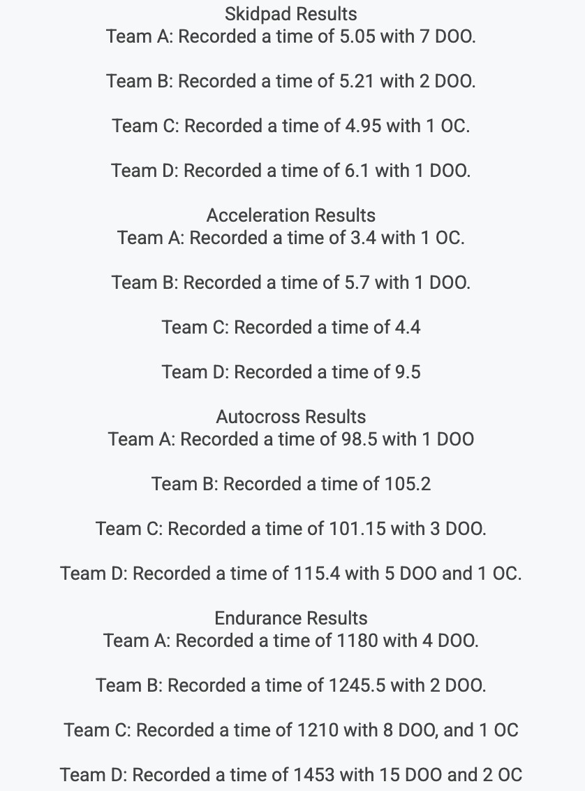

# Problem 979

The following data represents the performance of four teams (A, B, C, and D) across the dynamic events. Each entry includes the raw time in seconds (Tteam), Downed Cones (DOO), and Off-Course penalties (OC). During Autocross Post Inspection team A violated the rules without gaining an advantage and got a time penalty for that also at the endurance Post Inspection team C also violated the rules without gaining any advantage and got a similar time penalty Team D at the endurance tried to sneak past the post inspection, an aerodynamic package that was not rule-compliant, but the uptight scrutineers gave them a time penalty. All time penalties that post-inspection scrutineers give are according to the FS rules How many dynamic event points did the second-best team score? (assume only these 4 teams run dynamic events)(round to 2 decimals, e.g., 145.31). (8 points)

