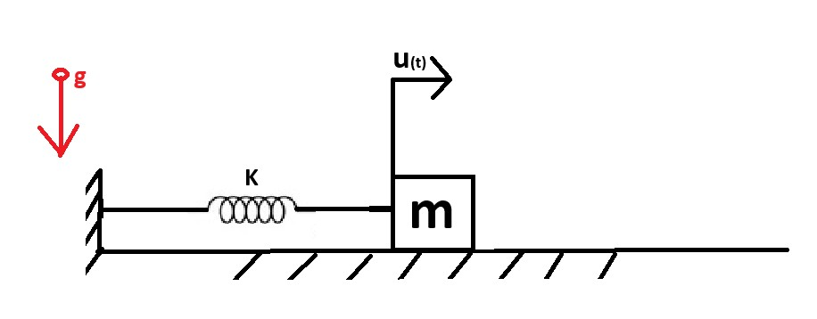

# Problem 981

An object with a mass of 10 Kilograms is connected to a spring of stiffness 500 Newton per yard. The friction coefficient is 0.4, and air resistance is negligible. At the spring's natural length, we consider u(t)=0. An initial displacement of 1 metre is given to the object, and it is let go at t=0 (u(t=0)=1 metre) with zero initial velocity. Find the total energy in joules that is lost during this experiment (the oscillation is losing energy only from the friction) (g= 9.81). (round to 2 decimals e.g., 145.31). (5 points)

