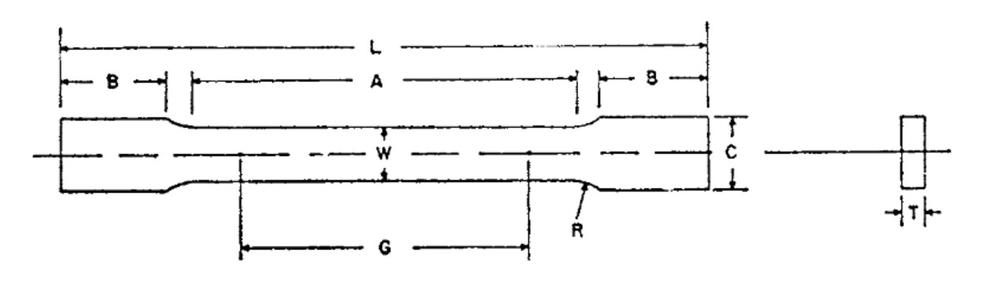

# Problem 982

The provided file contains data from a tensile test. The specimen dimensions are T and W = 10 mm, where T is equal to the maximum acceptable half-flex of a 12.7 mm safety wire, as specified in the Formula IHU 2026 Rules and Grey Areas Clarifications. Using this information, determine the Ultimate Tensile Strength (UTS) in GPa and round your answer to the nearest one decimal place. (4 points)

