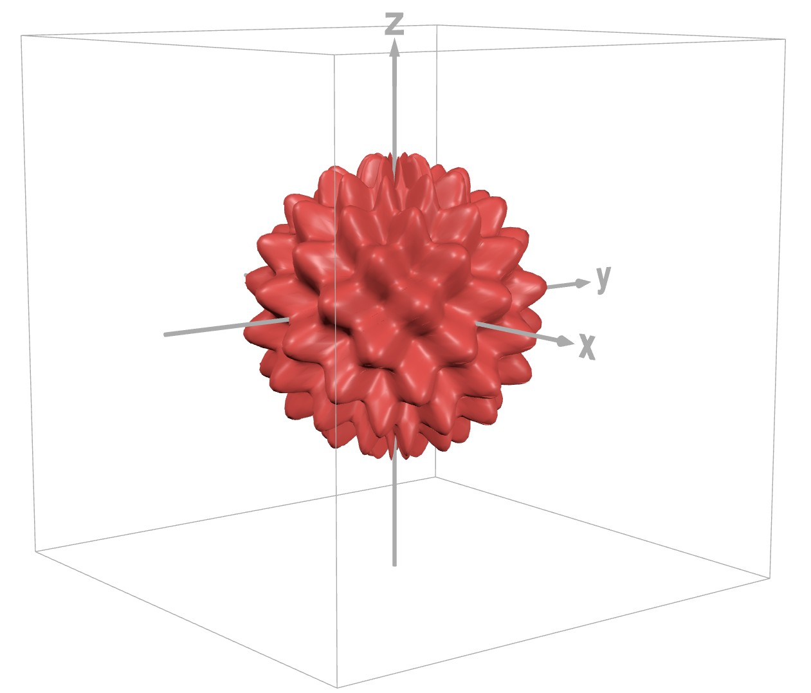

# Problem 983

Your favorite stress toy has the shape defined by the equation ρ=1 0.2sin(10θ)sin(10φ). Your lab professor recently acquired a 3D scanner and, for some reason, trusted you to use it. You began by measuring the volume of the stress toy that remains above the surface when floating in a bucket of fluid. This fluid is a rule-compliant radiator coolant per Formula Student Rule T7.2.1. The volume you measured above the liquid is 14% of the toy's total volume. Based on this information, what is the density of the stress toy? Answer in grams per cubic decimeter round to 2 decimal (answer format: 5.73). (2 points)

