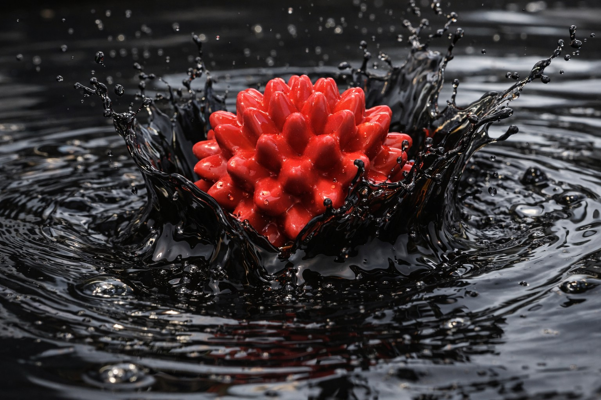

# Problem 984

You accidently drop your precious stress toy from the previous question in a vat of old engine oil with density of 0.86g/mL. For some reason, you feel the urge to calculate the volume of the stress toy that is above the surface of the oil, give the answer in cm³ (round to 2 decimals). (4 points)

