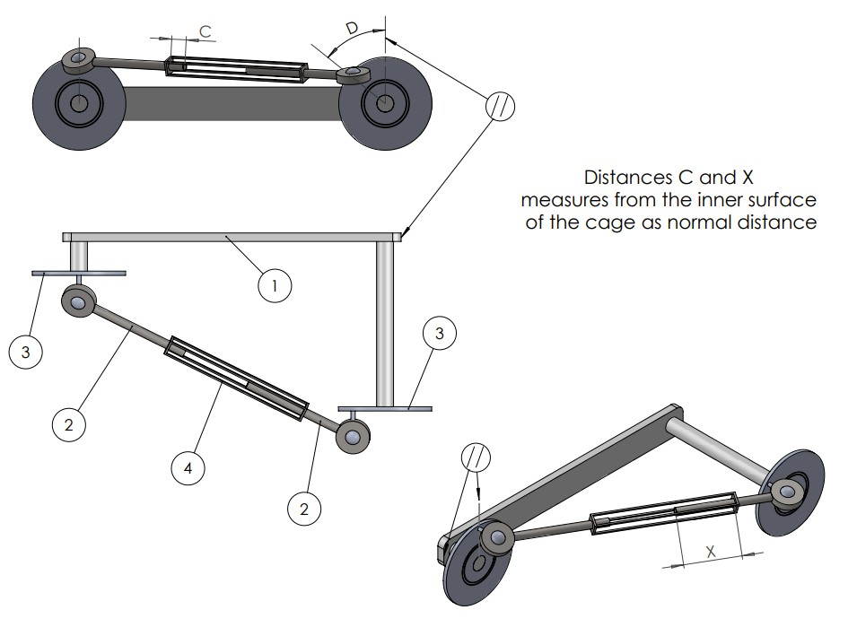

# Problem 988

ASSEMBLY DATA → Materials/Densities: Base=ABS 1020 kg/m³ | Rod=AISI 304 8000 kg/m³ | Wheel=1060 Alloy 2700 kg/m³ | Cage=AISI 1010 HR bar 7870 kg/m³ || Dimensions: A=400, B=40, C=20, D=50, E=5, F=120, G=2, H=175 || Units: MMGS (mm, g, s) || Required (from drawings): a) Assembly weight (g), round to 2 decimals (e.g. 123.12) | b) X value, round to 2 decimals (e.g. 123.15)Answer format: 123.12, 123.15 (7 points)

Link to the file fihu_assembly_high-combined.pdf: https://fs-quiz.eu/doc/quiz/fsaa26/fihu_assembly_high-combined.pdf

